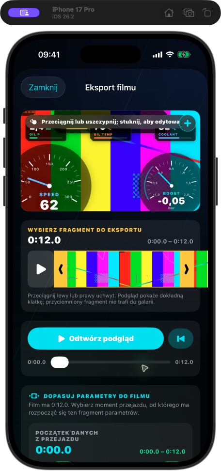
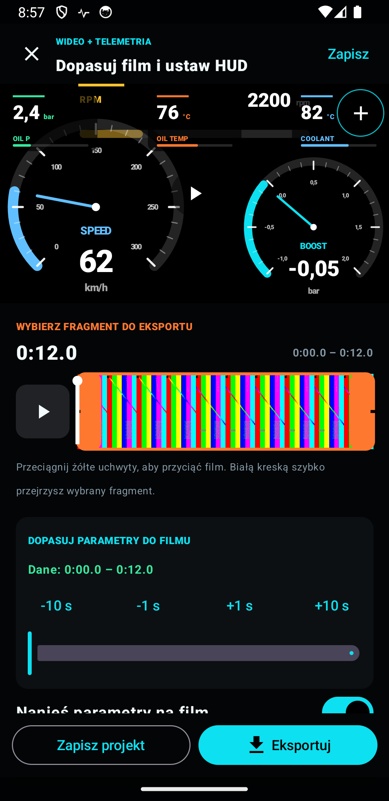
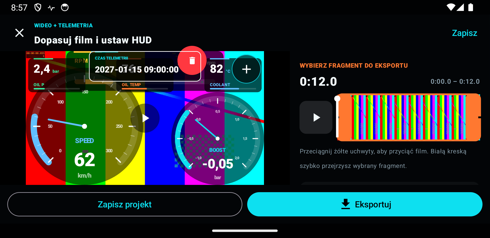
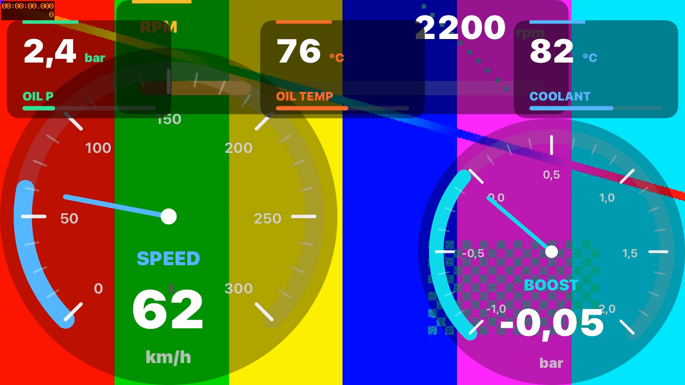
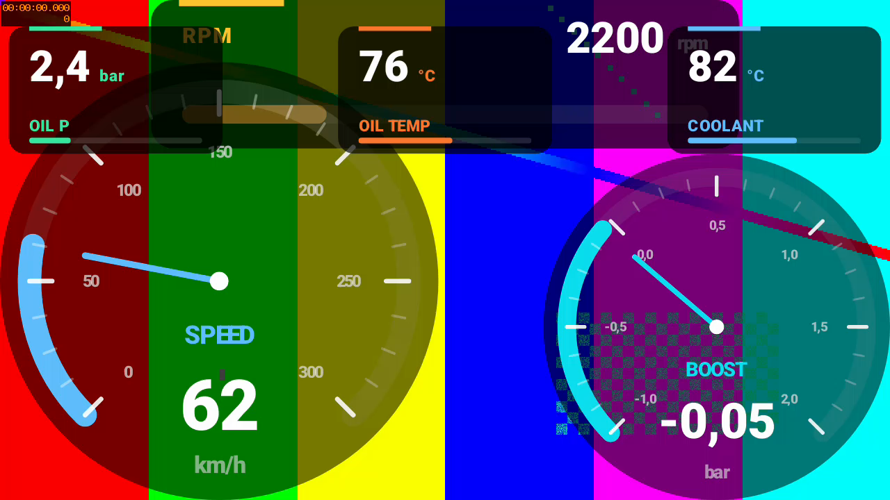
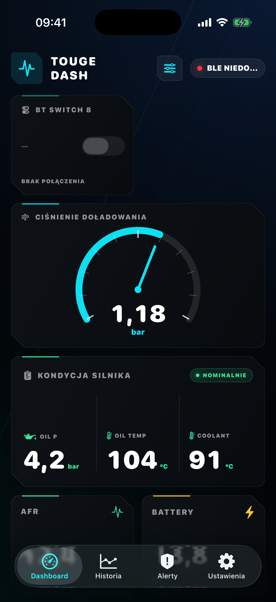
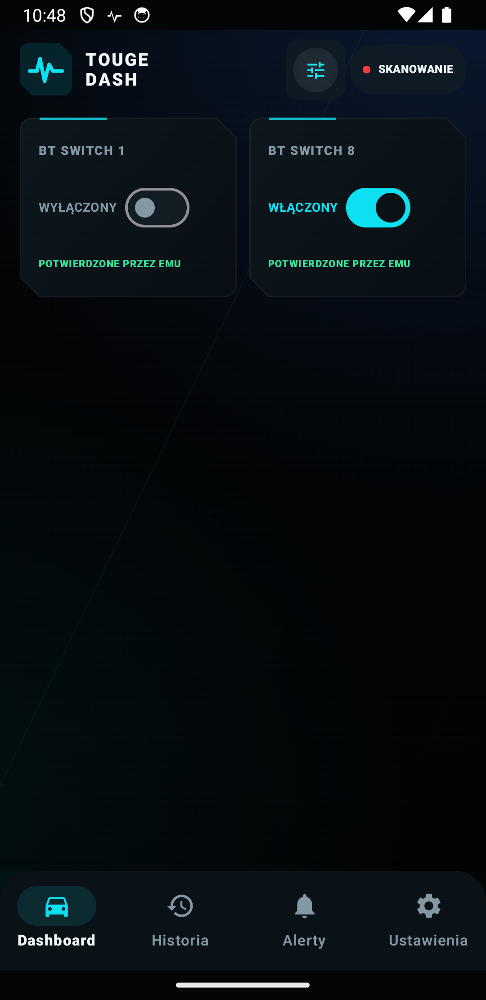
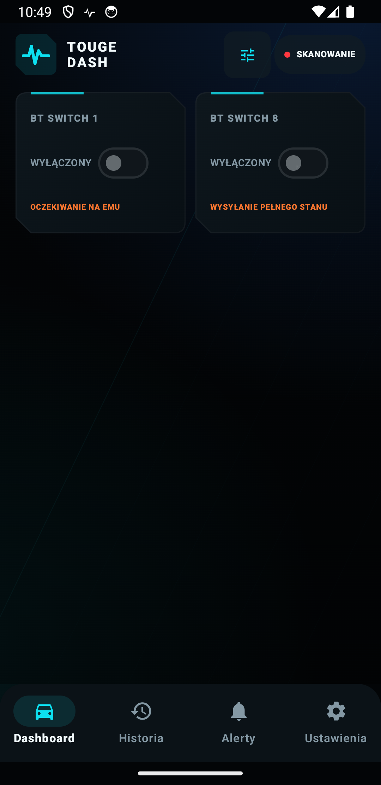
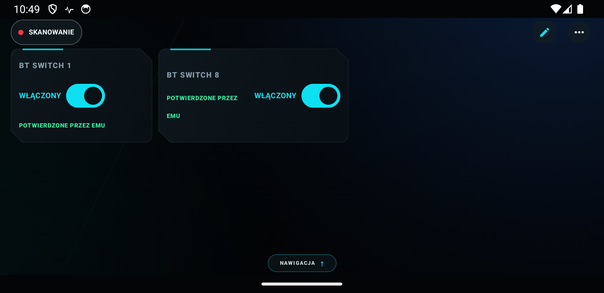

# Android / iOS — porównanie i poprawki z 25.10.2026

Punktem odniesienia jest bieżący kod iOS 1.4.5 (27). Porównanie obejmuje kod
obu aplikacji, uruchomiony iPhone 17 Pro / iOS 26.2 oraz Pixel 3a / Android 14.
Edytory i eksporty sprawdzono na tym samym wygenerowanym filmie testowym.

## Najważniejsze różnice i naprawy

| Obszar | Wcześniej na Androidzie | Po zmianie |
| --- | --- | --- |
| Gotowe HUD-y | Migracja JSON zmieniała `GAUGE` na `gauge`, odrzucając m.in. Touge Pro | Wszystkie 16 szablonów daje się odczytać, również ze starszym zapisem metryk i kolorów |
| Podgląd / eksport | Dwa odrębne renderery, różne rozmiary i wygląd widgetów | Wspólny renderer; rozmiary z referencyjnego płótna iOS; ograniczenie widgetów do obszaru obrazu |
| Edycja widgetów | Układ projektu ginął po zamknięciu edytora | Osobny zapis układu każdego projektu, usuwanie ostatniego widgetu, niezależne pozycje pionowe i poziome |
| Data i czas | Brak widgetu czasu telemetrii | Widget z czasem z osi przejazdu, również po przycięciu i przesunięciu danych |
| Eksport | Zawsze HUD i rozdzielczość źródła | HUD opcjonalny, szybki eksport do 1080p albo oryginalna rozdzielczość; domyślnie ta sama strategia odświeżania HUD-u co iOS |
| Praca w tle | Brak usługi eksportu; kamera przypięta do ekranu | Usługi z powiadomieniami; anulowanie eksportu; nagrywanie po schowaniu Activity; sprzątanie nieudanych plików |
| Oś czasu | Przycięcie mogło zmieniać synchronizację niezależnym ograniczeniem przesunięcia danych | Wspólna matematyka wyrównania, miniatury filmu, podgląd klatki i przesuwanie danych o 1 / 10 s |
| 70mai | Brak importu bezpośredniego | Profile dziewięciu modeli, przód/tył, autoryzacja, korekta zegara, dopasowanie nagrań i łączenie klipów z zachowaniem rzeczywistych przerw |
| Historia | Filmy pod wykresami, brak globalnej zakładki incydentów | Sekcje nagrań i projektów nad wykresami, zsynchronizowany odtwarzacz, zakładka incydentów i paliwo na wykresie ciśnień |
| Mapa | Statyczna trasa; błędne planowanie zdjęcia mapy przez niepodpięty View | Znacznik podąża za kursorem; działający start zdjęcia mapy; osobny wygląd jasnych i ciemnych minimap |
| Długość odcinków | Brak automatycznego limitu czasu | 15 / 30 / 60 minut, domyślnie 30; podział telemetrii, filmu, incydentów i pomiaru przyspieszenia na tej samej granicy |
| Interfejs i język | Ukryta nawigacja w pionie; brak wskazówki w zegarze; błąd kontekstu Activity przy zmianie języka | Stała nawigacja w pionie, nagłówek i kolory bliższe iOS, zegary ze wskazówką, poprawny język i uprawnienia także w oknach edytora |

Migracja Room 5 → 6 dopisuje opcjonalne pole układu filmu. Test migracji sprawdza
zachowanie istniejącego pliku, przycięcia i przesunięcia telemetrii.

## Ekrany z rzeczywistych uruchomień

iOS i Android — podgląd edytora:

<p>


</p>

Android — edytor w poziomie:



Zrzuty Androida pochodzą z testów UI; film, widgety i miniatury są faktycznie
renderowane. Próbki użyte w UI są syntetyczne. Natywne kontrolki i układ
systemowych pasków pozostają właściwe dla danej platformy.

Wyciągnięte klatki z rzeczywistych eksportów — iOS / Android:

<p>


</p>

## Osobny audyt BT Switch / BT Rotary

Sprawdzono historię poprawek iOS (`ec67c18`, `0a579c4`, `acfce63`) oraz ich
wcześniejszy port na Androida (`1f56f01`). W obu aplikacjach można dodać kartę
**Przełącznik ECU**, wybrać kanał **1–8** i sterować odpowiadającym mu BT Switch w EMU.
W iOS ręcznie dodano i zapisano kartę BT Switch 8 w symulatorze.

| Zachowanie | Wynik audytu Androida |
| --- | --- |
| Mapowanie SW 1–8 | Takie samo jak iOS: SW1 = bit 7, SW8 = bit 0 |
| Format zapisu | Osiem bajtów `08 55 switches rot12 rot34 rot56 rot78 checksum` |
| Pozostałe ustawienia ECU | Każdy zapis zachowuje wszystkie pozostałe switche i rotary |
| Pierwsze odblokowanie | Dopiero po odebraniu kanałów 254, 253 i 252 lub poprawnej pełnej ramki statusu |
| Powolny cykl telemetryczny | Grupy są zbierane przez czas połączenia, zgodnie z poprawką iOS |
| Potwierdzenie zmiany | Nowa odpowiedź właściwej grupy: 254 dla switcha, 253/252 dla rotary; wartość musi pasować |
| Brak potwierdzenia | Po 2 s powrót do ostatniego odczytu i komunikat błędu; bez automatycznego ponawiania |
| Reconnect | Wyczyszczenie stanu i obowiązkowy nowy odczyt; bez wysyłania stanu telefonu |
| Edycja / tło / podwójny tap | Brak sterowania w edycji i tle; jedna oczekująca zmiana naraz |
| Dozwolone BLE | NUS RX oraz FFE0/FFE2 lub starsze FFE0/FFE1; preferencja dedykowanego endpointu |

Dodatkowe naprawy:

- Odpowiedź GATT jest teraz powiązana z konkretnym poleceniem, połączeniem i
  instancją charakterystyki. Spóźniony błąd nie może anulować późniejszej zmiany.
  Potwierdzenie z EMU nie zwalnia przedwcześnie operacji zapisu GATT.
- Zapis jest blokowany przed zakończeniem konfiguracji powiadomień BLE. Utrata
  uprawnienia Bluetooth w chwili zapisu jest obsługiwana jako nieudany zapis.
- Dashboard czeka na wczytanie wybranego układu z Room, zanim pager zacznie
  zapisywać wybór strony; ekran ze switchami nie jest zastępowany atrapą fabryczną.
- Wąskie karty mają układ pionowy, komunikaty mogą zajmować dwa wiersze, a inne
  karty pokazują oczekiwanie na EMU podczas trwającego polecenia. Przełączniki
  i przycisk edycji w poziomie mają etykiety dostępności.

Dodano 13 testów regresji sterowania, w tym wszystkie osiem switchy i rotary,
spóźnione błędy, zły checksum, utratę transportu i ponowne połączenie. Osobny test
urządzeniowy przechodzi prawdziwy edytor dashboardu: dodanie SW8, zapis kanału,
kliknięcie i kontrolę wysłanych bajtów, potwierdzenie, timeout, reconnect, obrót,
tło oraz odtworzenie Activity. Fizyczne ECU zastępuje wyłącznie testowy writer
z kontrolowanymi odpowiedziami; test nie dowodzi działania radia z rzeczywistym EDL-1.

Zrzuty: iOS bez połączenia oraz Android po syntetycznej synchronizacji:

<p>



</p>



## Weryfikacja

Końcowe wspólne uruchomienie po audycie switchy: **80/80 testów jednostkowych
Androida, 21/21 testów na emulatorze, lint bez błędów**. Warianty `debug`,
`automotive` i `release` zbudowały się poprawnie. Pełna seria trwała 2 min 25 s.

Dodatkowe testy referencyjne iOS: **41/41 EMUProtocolTests**. W testach UI
usunięto dwa wyścigi samego testowania: odczyt Room przed zakończeniem zapisu
oraz dotyk podczas systemowej animacji obrotu. Wszystkie trzy testy UI
(dashboard ze switchami i oba scenariusze edytora HUD) przeszły osobno,
a następnie ponownie w końcowej pełnej serii 21 testów.

Pełny zestaw Androida:

```sh
cd android
JAVA_HOME=$(/usr/libexec/java_home -v 17) \
ANDROID_HOME="$HOME/Library/Android/sdk" \
./gradlew testDebugUnitTest lintDebug assembleDebug assembleAutomotive assembleRelease connectedDebugAndroidTest
```

Testy urządzeniowe obejmują rzeczywiste MP4 z dźwiękiem, eksport bez HUD-u,
przycięcie 3–7 s z danymi od 5 s, 4K → 1080p, eksport i kamerę w tle,
anulowanie, import galerii, układ zapisany w Room oraz gesty i obrót edytora.
Symulowana kamera HTTP przechodzi pełną autoryzację 70mai, pomiar zegara,
pobieranie i łączenie dwóch plików; test kontroluje także czarną klatkę w
rzeczywistej dwusekundowej przerwie oraz anulowanie zatrzymanego transferu.

iOS: pełny zestaw 116 testów przeszedł na iPhone 17 Pro / iOS 26.2. Dodatkowo
rzeczywisty eksport 12 s z HUD-em zapisano w Zdjęciach i sprawdzono przez ffprobe:
HEVC 1280×720, audio AAC, czas 12 s. Android zachował dźwięk AAC i czas
przycięcia, a osobny plik z wejścia 3840×2160 wyeksportował do 1920×1080.

Mała zmiana kodu iOS dotyczy wyłącznie jawnego przygotowania materiału QA w DEBUG.
Po ustawieniu `TOUGE_DASH_HISTORY_PREVIEW=1` oraz
`TOUGE_DASH_VIDEO_PREVIEW_PATH=/pełna/ścieżka/do/filmu.mp4` można otworzyć prawdziwy
edytor na powtarzalnym materiale. Kod ten nie trafia do wydania Release.

## Granice weryfikacji

Testy nie zastępują jazdy z fizycznym EDL-1 i Androidem ani testu każdej wersji
firmware fizycznych kamer 70mai. Dostępne środowisko pozwala potwierdzić działanie
emulatorów, kontrakt protokołu i rzeczywiste kodowanie, zapis oraz odtwarzanie plików.
APK `debug` służy do testów. Wydanie produkcyjne Android 1.9.0 (kod 25)
publikuje workflow `Publish Android APK` dla tagu `android-v1.9.0`, korzystając
z dotychczasowego klucza podpisującego przechowywanego w sekretach GitHuba.
